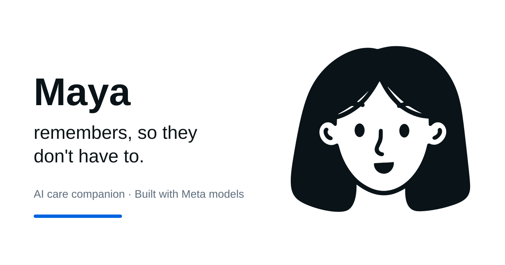

# Maya

### Watching over, without watching.

An AI care companion prototype for older adults living with memory loss, and the families who look after them. Maya remembers where everyday objects were last seen, relays caregiver-written messages, and routes health questions to a caregiver.

**Meta Global AI Developer Hackathon 2026 · Build for Your World · Indie developer**  
Built by **Fairoz Sameha** with SAM 3.1, Muse Spark 1.3, and Muse Voice Transcribe.

**[Live website](https://maya-web.fsameha.workers.dev)** · **[Watch the story](https://maya-web.fsameha.workers.dev/demo)** · **[Inspect the proof](https://maya-web.fsameha.workers.dev/proof)** · **[Source code](https://github.com/fsameha/maya)**



> **Demo status:** This website replays recorded model outputs on the creator's footage and needs no API keys. Caregiver interactions are scripted; inactivity escalation is simulated. It is an interactive prototype presentation, not a live care service. [Known limits](docs/LIMITS.md)

## Explore the demo

| Page | What to look for |
| --- | --- |
| **Story** — `/demo` | Six chapters across the home camera, Maya, and the caregiver's phone. Watch the glasses answer, then the health-question routing. |
| **Proof** — `/proof` | Synchronized SAM 3.1, YOLO11, and RT-DETR videos, methodology, and recorded evaluation results. |
| **How it works** — `/demo#how` | Inspect masks, object memory, tool calls, policy decisions, and source code. |
| **Guided replay** — `/try` | Optional camera preview/capture with placeholder analysis. It does **not** analyze your room. |
| **Trust** — `/trust` | Prototype boundaries and intended caregiver permissions. |

## Why Maya

An everyday search for glasses can become another call to a family member. A remembered location can help, but a care companion must also know when to stop: finding a pill bottle is different from deciding whether someone should take another pill.

Maya explores that boundary with one rule: **the models perceive and phrase; application code decides.**

- **Object memory:** Sightings become timestamped locations and item states. Answers say *last seen*, rather than claiming an object is still there.
- **Grounded conversation:** Muse Spark calls tools such as `find_object` and words answers from returned facts.
- **Caregiver control:** A policy gate routes health questions to `ask_caregiver`. Maya has no tool that creates a reminder. Approvals in the replay are scripted.
- **Inspectable evidence:** Recorded events expose model requests, masks, tool calls, timing, and estimated costs.
- **A voiced companion:** An SVG character follows the player clock with gaze, expressions, and audio-aligned lip-sync.

**Not a medical device.** Maya does not provide medical advice, detect falls, prevent harm, or contact emergency services.

## How Meta models are used

| Model | Implemented role | Evidence |
| --- | --- | --- |
| **SAM 3.1** | Video detection and tracking for short concepts such as `glasses`, `white bottle`, and `person`; masks and stable IDs within a clip. | [Recording script](scripts/record.mjs), [outputs](fixtures/run-001/perception/) |
| **Muse Spark 1.3**, standard tier | Six-tool conversation loop and a structured health classifier used by the policy gate. | [Agent](lib/maya/agent.ts), [policy](lib/maya/policy.ts), [request ledger](fixtures/run-001/requests.json) |
| **Muse Voice Transcribe** | Speech-to-text demonstrated on one recorded glasses question in the kill test. | [Kill-test script](scripts/killtest.mjs), [transcription](fixtures/killtest/out/asr.json) |

**Disclosure:** Maya's demo voice uses **ElevenLabs / Matilda**, rendered in advance with character timestamps. No ElevenLabs or Meta API calls happen while browsing the deployed replay. Some human dialogue assets are silent placeholders; staged dialogue is not a complete live ASR session. YOLO11 and RT-DETR are offline benchmark baselines, not product models. [Model details](docs/MODELS.md)

## Architecture

```text
Creator's recorded clips
        │
        ▼
SAM 3.1 → sightings + masks → deterministic object memory
                                      │
Recorded question → policy gate → Spark tool loop → grounded answer
                                      │
                                      ▼
                            MayaEvent JSON + audio
                                      │
                                      ▼
                      Next.js replay on Cloudflare Workers
                         camera │ companion │ caregiver
```

Model calls and evaluation run in local scripts. The website loads recorded `MayaEvent` data through `MayaSource`; its player reconstructs the same state on play, pause, and seek.

| Layer | Implementation |
| --- | --- |
| Website | Next.js 16, React 19, TypeScript, Astryx, Tailwind CSS, GSAP, Motion |
| State and rules | [Event contract](lib/contract.ts), [player](lib/player.ts), [memory](lib/maya/memory.ts), [policy](lib/maya/policy.ts) |
| Character and audio | [SVG rig](components/maya/), [lip-sync](lib/lipsync.ts), [audio scheduler](lib/audio.ts) |
| Deployment | Cloudflare Workers through OpenNext |
| Verification | Vitest, Playwright, TypeScript, ESLint, copy checks |

The planned live backend—D1, R2, Durable Objects, scheduled checks, and model proxies—is **not implemented**. Caregiver pairing uses `BroadcastChannel` between tabs of the same browser; cross-device pairing is unfinished. [Architecture](docs/ARCHITECTURE.md)

## Recorded results

These are supplied experiment results, not a new evaluation performed during deployment.

### Object tracking

Two 1080p home-camera clips, 15 fps, 257 scored frames. Reference boxes start from SAM outputs and were checked on contact sheets; **SAM recall is not independently scored**.

| Model | Glasses category | Bottle recall @ IoU 0.5 | Bottle ID switches | Reported processing time |
| --- | --- | --- | --- | --- |
| YOLO11s | Unavailable in its closed-set classes | 0.675 | 0 | 158 ms/frame, local CPU |
| RT-DETR-L | Unavailable in its closed-set classes | 0.507 | 1 | 977 ms/frame, local CPU |
| SAM 3.1 | Open-vocabulary; one ID within each clip | Reference source, not scored | One distinct ID per clip | 59 ms/frame, hosted service |

CPU and hosted timings use different hardware. Grounding DINO was attempted but did not complete in the allotted CPU time; no result is claimed. This is evidence on two clips in one room, not a general model ranking. [Metrics and methodology](fixtures/benchmark/metrics.json) · [Benchmark scripts](benchmark/)

### Routing, latency, and cost

- **Health routing:** 20/20 health utterances routed to the caregiver in a 40-case evaluation. One of 20 ordinary questions was also routed: “Where is my pill bottle?” This small test does not establish clinical safety.
- **Recorded response latency:** 10.9–24.9 seconds, including classification and the Spark tool loop. Replay pacing is edited.
- **Estimated daily inference cost:** $16.56 SAM + $0.202 Spark, assuming 184 ten-second clips, three concepts at 15 fps, and 20 questions. This is an estimate, not measured production usage or hosting cost.

[Evaluation results and assumptions](fixtures/eval/results.json)

## Run locally

Use Node.js **22 or newer** and **pnpm 12.14.0**. The transfer was prepared on Node.js 26.12.0. API keys, Python, and a GPU are unnecessary for the website.

```bash
git clone https://github.com/fsameha/maya.git
cd maya
npm install --global pnpm@12.14.0
pnpm install --frozen-lockfile
pnpm dev
```

Open **http://localhost:3000**. The `predev` and `prebuild` hooks copy deployable fixtures into `public/fixtures` automatically.

```bash
pnpm typecheck
pnpm lint
pnpm check:copy
pnpm test
pnpm build
pnpm e2e
```

### Deploy to Cloudflare

```bash
pnpm exec wrangler login
pnpm deploy
```

The Worker is named `maya-web` in [wrangler.jsonc](wrangler.jsonc). `pnpm deploy` builds the OpenNext Worker and uploads the website assets; `pnpm preview` builds and runs the Worker locally. Set `NEXT_PUBLIC_SITE_URL` at build time to your deployed origin for social metadata.

### Optional: regenerate model evidence

Copy `.env.example` to `.env` and enter credentials **locally**. Keep `.env` out of Git. These commands make API calls and can incur costs; they are not part of installation or deployment.

```bash
pnpm killtest
pnpm record --run run-001
python scripts/extract_media.py
node scripts/build-run.mjs
pnpm voice:render
pnpm eval
```

`MODEL_API_KEY` is for the Meta scripts. `ELEVENLABS_API_KEY` is for voice rendering. Python media/benchmark scripts also require their own dependencies and model weights. [Model documentation](docs/MODELS.md)

## Limitations and data handling

- This is a recorded prototype. Live inference, authenticated caregiver delivery, persistent permissions, and scheduled escalation are unfinished.
- The quiet-morning sequence is simulated. Identity comparison is an illustration. Try uses placeholder analysis, not inference on the visitor's camera capture.
- Published demo media are creator-recorded presentation assets. The planned 24-hour retention and wake-word pipeline are not deployed features.
- Raw phone footage in `incoming/`, credentials, dependencies, and build caches are excluded from Git.

[Full limitations](docs/LIMITS.md) · [Trust](docs/TRUST.md)

## Project guide

```text
app/               Routes and page metadata
components/        Story, walkthrough, comparison, character, guided replay
lib/maya/          Deterministic memory, agent tools, and policy gate
fixtures/          Recorded events, model evidence, audio, benchmark results
scripts/           Recording, evaluation, media preparation, fixture sync
benchmark/         Offline baselines and scoring
tests/ · e2e/      Unit tests and browser smoke tests
docs/              Architecture, model disclosure, limits, submission notes
```

## Hackathon and authorship

Created by **Fairoz Sameha**, a solo builder, for the [Meta Global AI Developer Hackathon](https://cerebralvalley.ai/e/meta-ai-developer-hackathon). Developed during the October 26–November 4, 2026 hackathon window with AI coding assistants; footage filmed by the creator. This repository was imported from the transfer archive, which did not contain the original Git history. Publication and deployment preparation continued on November 5.

[Submission draft](docs/SUBMISSION.md) · [Narration and capture guide](docs/VOICEOVER.md) · [Demo-readiness review](docs/DEMO_READINESS.md)

## License

Application code: [MIT](LICENSE). Offline benchmark dependencies retain their own licenses; Ultralytics/YOLO tooling is AGPL-3.0. Model APIs and generated outputs remain subject to their providers' terms.
